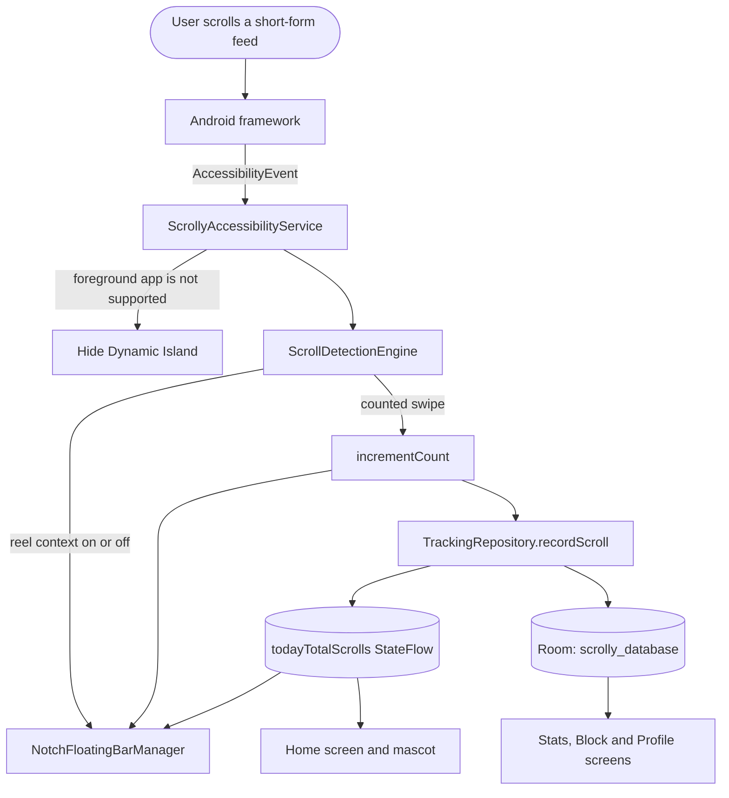
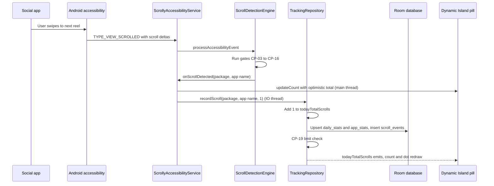
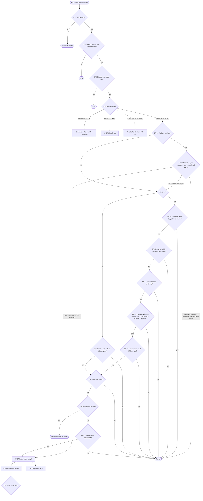
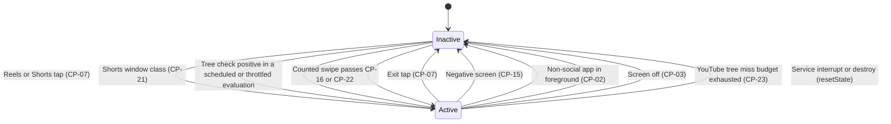

# Scrolly (BrainRot)

Scrolly is an Android app that measures how much you scroll through short-form video feeds (Instagram Reels, YouTube Shorts, TikTok, Facebook Reels, Snapchat Spotlight, and Spotify Video) and shows the count live in a floating "Dynamic Island" pill over those apps. It adds a daily goal, a per-app limit, a brain mascot that reacts to your usage, friend battles, and achievements to make the numbers easier to act on.

The Android application ID is `com.scrolly.health`; the Kotlin namespace is `com.example`. The repository is named **BrainRot**; the app is branded **Scrolly**.

> This README was written from the source code at commit `713ed00` (branch `main`). Behaviour described here is what the code does. Items that are incomplete or appear broken are collected in [Known limitations](#11-known-limitations).

---

## Table of contents

1. [What the app is](#1-what-the-app-is)
2. [Features and how they work](#2-features-and-how-they-work)
3. [Architecture](#3-architecture)
4. [Workflow diagram](#4-workflow-diagram)
5. [Scroll counter logic (checkpoint by checkpoint)](#5-scroll-counter-logic-checkpoint-by-checkpoint)
6. [Dynamic Island overlay](#6-dynamic-island-overlay)
7. [Data storage](#7-data-storage)
8. [Permissions and privacy](#8-permissions-and-privacy)
9. [Tech stack](#9-tech-stack)
10. [Build, install and run](#10-build-install-and-run)
11. [Known limitations](#11-known-limitations)
12. [Repository layout](#12-repository-layout)

---

## 1. What the app is

Short-form video feeds are built around a vertical swipe: one swipe, one new video. Scrolly counts those swipes.

It has three parts:

- **A detector.** An Android `AccessibilityService` listens for UI events from supported apps, decides whether the user is currently inside a Reels/Shorts-style viewer, and counts each qualifying vertical swipe as one scroll.
- **A counter and a dashboard.** Counts are stored in a local Room database and shown on a Home dashboard, a Stats page (day, week, month, year), and a floating pill overlay.
- **Motivation and controls.** Per-app daily limits, a daily goal, a mascot that changes expression with your usage, friend battles, healthy-break challenges, and achievements.

Detection, counting, and storage all run on the device. The only network use in the current code is Firebase: anonymous sign-in, plus Firestore for the username and friends list.

---

## 2. Features and how they work

### 2.1 Live scroll counter (Dynamic Island pill)

- **What you see:** a black pill with a 🔥 icon, the day's total scroll count, and a status dot (green, amber, or red) drawn over the social app while you are in a Reels/Shorts viewer.
- **How it works:** the accessibility service calls `NotchFloatingBarManager.show()` when a reel context is confirmed and `forceHide()` when it ends. Each counted swipe calls `updateCount()`. The count text is bound to the `todayTotalScrolls` `StateFlow` in `TrackingRepository`, so the pill updates as soon as the number changes.
- **Dot colour:** red when the count is at or above the daily goal, amber at 80% of the goal or more, green otherwise.
- **Instagram pulse:** on Instagram only, each accepted Reel snap flashes the dot yellow for about 0.8 s (100 ms fade-in, 500 ms hold, 180 ms fade-out).
- **Placement:** configurable, with automatic cutout detection (see [section 6](#6-dynamic-island-overlay)).

### 2.2 Supported apps

Defined in `AppRecognitionEngine.SUPPORTED_APPS`:

| Display name         | Package IDs                                                                 | Detection signal (summary)                                                   |
|----------------------|-----------------------------------------------------------------------------|------------------------------------------------------------------------------|
| Instagram Reels      | `com.instagram.android`, `com.instagram.lite`                               | `clips_viewer_view_pager` view ID, selected Reels tab, "Reels" header, swipe geometry |
| YouTube Shorts       | `com.google.android.youtube`                                                | Shorts pager/container view IDs (`reel_recycler`, `reel_player_page_container`, `reel_watch_fragment_root`, …), selected "Shorts" tab, full-screen pager geometry plus a full-screen video surface, sticky Shorts session (see [CP-21](#cp-21-youtube-shorts-session)–[CP-23](#cp-23-youtube-transient-tree-miss-retry)) |
| TikTok               | `com.zhiliaoapp.musically`, `…musically.go`, `com.ss.android.ugc.trill`, `com.ss.android.ugc.aweme` | Treated as always-on vertical video; only excluded screens are ignored     |
| Facebook Reels       | `com.facebook.katana`, `com.facebook.lite`                                  | Composer sticker/GIF text, selected Reels/Watch tab, "Reels" header, structural fallback |
| Snapchat Spotlight   | `com.snapchat.android`                                                      | `spotlight_container` view ID (partial, see [limitations](#11-known-limitations)) |
| Spotify Video        | `com.spotify.music`, `com.spotify.lite`                                     | Listed, but has no detection branch, so it does not currently produce counts |

### 2.3 Scroll counting

A "scroll" is one accepted vertical swipe to the next item in a short-form feed. Time spent watching is not measured. The rules that decide whether a swipe counts are described in [section 5](#5-scroll-counter-logic-checkpoint-by-checkpoint).

### 2.4 Home dashboard

- **Brain mascot:** `BrainMascotState.fromDailyScrolls()` maps today's count and goal to one of seven expressions (Serene, Happy, Dazed, Fatigued, Fried, Cooked, Meltdown) and six intensity levels (Minimal, Light, Moderate, Elevated, Intense, Nuclear). Tapping the mascot shows a short reaction line.
- **Permission checklist:** reports whether the accessibility service, "Display over other apps", and battery-optimisation exemption are in place, with buttons that open the matching Settings screens.
- **Simulate scroll:** adds +1, +5, or +20 scrolls for a chosen app. This goes through the same `recordScroll()` path as a real detection, so you can test the counter and the pill without opening a social app.
- **Dynamic Island customiser and preview:** choose placement mode and notch type, nudge the position, and preview the pill. Changes are saved to `SharedPreferences` through `NotchSettingsRepository`.

### 2.5 Stats

Day, Week, Month, and Year views built from `daily_stats` and `app_stats`. Each view shows totals, a bar chart (weeks start on Monday; months with more than 28 days get a "W5" bar for days 29 onward), a daily average, and a per-app breakdown with a short text insight. Previous and next buttons move through periods.

### 2.6 Block (per-app limits and healthy challenges)

- **Per-app daily limits:** each app has a `dailyLimit`, `warningThreshold`, and `isEnabled` flag, stored in `app_limits`. Defaults: Instagram 100, YouTube Shorts 75, Facebook 60, Snapchat 50, TikTok 80.
- **Limit-reached flag:** when a recorded scroll pushes an app's count to its limit, the repository sets `isBlocked = true` and emits a `LimitReachedEvent`. Nothing currently collects that event (see [limitations](#11-known-limitations)).
- **Healthy challenges:** four short offline tasks (Touch Grass Walk, Phone-Down Reset, Box Breathing Reset, Desk Posture Stretch). Each has a reward. Completing one calls `unblockAppTemporarily()`, which raises the app's daily limit by the bonus and clears the blocked flag. The challenges are not timed or verified by the app.

### 2.7 Friend battles

Battles are stored in `friend_battles` (`WINNING`, `LOSING`, `TIED`, `COMPLETED`). Two seed battles are created on first install. "Start Battle" creates a new record with placeholder scores. Lower scroll count wins, but no code updates battle scores from real counts yet.

### 2.8 Profile, achievements, and friends

- **Profile:** username (saved to `SharedPreferences` and Firestore). Level, XP, streak, and all-time totals currently come from hard-coded defaults in `UserProfile`.
- **Achievements:** six seeded rows in `achievements` (First Step, Under 100, 7-Day Streak, Touch Grass Champion, Scroll Ninja, Zen Master). Their progress is not yet updated by any code path.
- **Friends:** each user has an anonymous Firebase UID. Inviting a friend uses the deep link `scrolly://invite?uid=<uid>`. Opening it calls `SocialRepository.connectFriend()`, which writes a `friends` document on both sides in Firestore.

---

## 3. Architecture

The app follows a three-layer layout: **tracking** (Android services and detection), **data** (Room and repositories), and **UI** (Jetpack Compose and ViewModels). Repositories are created once in `ScrollyApp.onCreate()` and shared by the service and the UI.

```
app/src/main/java/com/example/
├── MainActivity.kt            Compose host; detects notch on launch; handles scrolly://invite
├── ScrollyApp.kt              Application: builds DB and repositories; anonymous Firebase sign-in
├── tracking/
│   ├── accessibility/         ScrollyAccessibilityService, AccessibilityHelper (permission checks)
│   ├── detector/              ScrollDetectionEngine, YouTubeShortsRules (pure Shorts swipe rules),
│   │                          AppRecognitionEngine, DisplayCutoutDetectionService,
│   │                          NotchDetectionHelper
│   └── overlay/               NotchFloatingBarManager (WindowManager pill),
│                              DynamicIslandAnimationController
├── data/
│   ├── local/                 ScrollyDatabase (Room), ScrollyDao, Entities
│   └── repository/            TrackingRepository, GamificationRepository (+ SocialRepository),
│                              NotchSettingsRepository, FirebaseManager
└── ui/
    ├── navigation/            ScrollyNav (bottom bar: Home, Stats, Battles, Block, Profile)
    ├── screens/               home, stats, battles, block, profile (each with a ViewModel)
    ├── mascot/                BrainMascotState, BrainMascotViewModel
    ├── components/            ScrollyCharacter, NotchBarPreview, NotchDynamicIslandCustomizer, AppBadge
    └── theme/                 Color, Theme, Type
```

### Key classes

| Class | Responsibility |
|-------|----------------|
| `ScrollyAccessibilityService` | Entry point for UI events. Tracks the foreground package, force-hides the pill for non-social apps, and forwards every event to `ScrollDetectionEngine`. Owns the `NotchFloatingBarManager`. |
| `ScrollDetectionEngine` | All counting logic: gates, debounce, reel-context state machine, and per-app detectors. Pure decision logic with one side-effect callback for a count. |
| `AppRecognitionEngine` | Static map of supported package IDs to display names. |
| `TrackingRepository` | Owns the live count (`todayTotalScrolls`), writes each scroll to Room, and runs limit checks. |
| `NotchFloatingBarManager` | Adds and removes the overlay window, updates the count and dot colour, and positions the pill. |
| `NotchSettingsRepository` | Stores overlay placement and cutout data. Auto-calibrates from the detected notch. |
| `GamificationRepository` / `SocialRepository` | Healthy challenges, profile, friends, and battles. |
| `FirebaseManager` | Anonymous auth, username, friends, and a scroll-sync method that is currently unused. |

---

## 4. Workflow diagram

### 4.1 System-level flow



### 4.2 Sequence for one counted swipe



### 4.3 Decision flow for the counter

Each numbered node matches a checkpoint in [section 5](#5-scroll-counter-logic-checkpoint-by-checkpoint).



---

## 5. Scroll counter logic (checkpoint by checkpoint)

This section describes the exact path an event takes from the accessibility framework to a saved count. The main logic lives in `ScrollDetectionEngine.kt`, with the service wiring in `ScrollyAccessibilityService.kt` and persistence in `TrackingRepository.kt`.

### 5.1 Overview

- **Input.** Accessibility events from supported packages: window changes, content changes, view clicks, and view scrolls. Scroll events carry `scrollDeltaX` and `scrollDeltaY` on Android 9 (API 28) and later.
- **Output.** A call to `onScrollDetected(packageName, appName)`, which increments the count by 1 and persists it. A separate callback, `onReelVisibilityChanged`, shows or hides the pill.
- **State the engine keeps.**

  | Field | Meaning |
  |-------|---------|
  | `isCurrentlyWatchingReels` | The pill is active and the user is inside a reel viewer (the "reel active" flag). |
  | `cachedIsReelContext` | Reel context was last confirmed by a tap, a tree check, or an earlier event. Used as a shortcut so each swipe does not need a full tree scan. |
  | `lastScrollTimestamp` | Time of the last counted swipe. Drives the debounce and cooldown. |
  | `lastEvalTimestamp` | Time of the last context evaluation. Drives the content-change throttle. |
  | `instagramCommentSheetOpenedAt` | Time of the last Instagram comment-button tap. Starts the comment-sheet suppression window. |
  | `lastInstagramEventTimestamp` | Time of the previous Instagram scroll event that reached the velocity check. Used to estimate velocity. |
  | `currentPackage` | The last supported package seen. |

- **What counts as one scroll.** For Instagram, one completed forward Reel snap. For other apps, one vertical scroll event that passes every gate. Scrolls are counted regardless of how long you watch.

### 5.2 Checkpoints

Each checkpoint lists where it lives, what it checks, what happens on pass or fail, and why it exists.

#### CP-01: Event subscription and service configuration
- **Where:** `res/xml/accessibility_service_config.xml`, `ScrollyAccessibilityService.onServiceConnected()` → `applyServiceInfo()`.
- **Checks:** the service subscribes to `TYPE_WINDOW_STATE_CHANGED`, `TYPE_WINDOW_CONTENT_CHANGED`, `TYPE_WINDOWS_CHANGED`, `TYPE_VIEW_SCROLLED`, and `TYPE_VIEW_CLICKED`. It uses `notificationTimeout = 100`, `FLAG_REPORT_VIEW_IDS`, `FLAG_RETRIEVE_INTERACTIVE_WINDOWS`, and `canRetrieveWindowContent = true`.
- **How:** `applyServiceInfo()` reads the service's current `AccessibilityServiceInfo`, ORs the two flags into it, and writes it back, then logs whether `FLAG_REPORT_VIEW_IDS` actually stuck. Replacing the object instead would drop the XML defaults and is ignored on some OEM builds.
- **Pass:** events are delivered to `onAccessibilityEvent`.
- **Fail:** if the user has not enabled the service in Settings, nothing is counted. The Home screen shows this state. If the view-id flag did not stick, `viewIdResourceName` is always null and YouTube Shorts counting falls back to session and geometry evidence (CP-21, CP-22).
- **Why:** these are the only inputs the counter has. The service does not install touch listeners or intercept gestures.

#### CP-02: Foreground tracking and non-social guard
- **Where:** `ScrollyAccessibilityService.onAccessibilityEvent()`, window-state branch.
- **Checks:** for every `TYPE_WINDOW_STATE_CHANGED`, the service records the package and class in `foregroundPackageFlow` and `windowTitleFlow`. If the package is not supported and is not an ignored UI package, it posts a `forceHide()` to the main thread when the pill is active.
- **Pass / effect:** the pill disappears as soon as a non-social app takes the foreground.
- **Why:** the counter must never stay on screen over the home screen or other apps.

#### CP-03: Screen-on gate
- **Where:** `ScrollDetectionEngine.processAccessibilityEvent()`, first check.
- **Checks:** `PowerManager.isInteractive`.
- **Pass:** continue.
- **Fail:** if the reel flag is on, it is turned off (`[SCREEN_OFF]` log). The event is dropped. Nothing is counted while the screen is off.
- **Why:** prevents phantom counts from background or ambient events.

#### CP-04: Package and system-UI filter
- **Where:** `processAccessibilityEvent()` and `isIgnoredSystemPackage()`.
- **Checks:** the event must have a package name. These packages are ignored: the app itself, `com.example`, `android`, `com.android.systemui*`, anything containing `inputmethod` or `keyboard`, `com.google.android.gms`, `com.google.android.webview`, and `com.android.vending`.
- **Pass:** continue.
- **Fail:** drop the event.
- **Why:** keyboards, status bar, and Play services produce many events that are never social feeds.

#### CP-05: Supported-app gate
- **Where:** `processAccessibilityEvent()` using `AppRecognitionEngine.isSupported()`.
- **Checks:** the package is one of the entries in `SUPPORTED_APPS`.
- **Pass:** continue. The app name is looked up and `currentPackage` is updated.
- **Fail:** for window events, `currentPackage` is updated and the reel flag is turned off if needed. Other event types are dropped.
- **Why:** scope limit. Only known feed apps are tracked.

#### CP-06: Event-type router
- **Where:** `processAccessibilityEvent()`.
- **Routes:**
  - `TYPE_WINDOW_STATE_CHANGED` → `evaluateScreenContext(force = true)` and return. `force` marks the event as a real screen change, which is the only situation where a negative tree scan may end a YouTube Shorts session ([CP-23](#cp-23-youtube-transient-tree-miss-retry)). For a YouTube window whose class name contains `shorts`, the session is opened straight away ([CP-21](#cp-21-youtube-shorts-session)).
  - `TYPE_VIEW_CLICKED` → `handleViewClicked()`. If the reel flag is on, also schedules a tree re-check.
  - `TYPE_VIEW_SCROLLED` → `handleScroll()`. This is the only path that counts. For `com.google.android.youtube` the event is first given to `handleYouTubeShortsScroll()` ([CP-22](#cp-22-youtube-shorts-swipe-rules)); if that path does not decide the event, the shared gates below still apply.
  - `TYPE_WINDOW_CONTENT_CHANGED` or `TYPE_WINDOWS_CHANGED` → if 250 ms or more have passed since the last evaluation, evaluate now. Otherwise schedule an evaluation 300 ms later. Each new schedule cancels the previous pending one.
  - Any other type → ignored.
- **Why:** content changes can be very frequent. Throttling keeps the tree scans cheap.

#### CP-07: Tap classification
- **Where:** `handleViewClicked()`.
- **Checks the tap's text, content description, and view ID:**
  - **Instagram comment tap** (text or ID contains `comment`): sets `instagramCommentSheetOpenedAt` to now, which starts the suppression window in CP-08.
  - **Reels/Shorts tap** (text contains `reels`, `shorts`, or `spotlight`; ID contains `reels`, `clips`, or `shorts`): sets `cachedIsReelContext = true` and turns the reel flag on if it was off.
  - **Exit tap** (text contains words such as `home`, `search`, `explore`, `friends`, `notifications`, `profile`, `direct`, `messages`, `subscriptions`, `library`, `you`, `close`, `back`; or ID contains `home_tab`, `search_tab`, `profile_tab`, `action_bar_button_back`): sets `cachedIsReelContext = false` and turns the reel flag off if it was on.
- **Note:** matching is substring-based, so `you` also matches "your" and `back` matches many labels. See [limitations](#11-known-limitations).

#### CP-08: Instagram comment-sheet time window
- **Where:** `handleScroll()`, Instagram branch.
- **Checks:** `now - instagramCommentSheetOpenedAt < 1200 ms`.
- **Fail:** reject. Logs `[SCROLL] Rejected — Instagram comment sheet is animating`.
- **Why:** when the comment sheet animates in, Instagram emits programmatic scroll events. Without this window those would be counted as reel swipes.

#### CP-09: Instagram comment-container ancestor walk
- **Where:** `isNodeInsideCommentContainer()`.
- **Checks:** starting at the scroll event's source node, walk up to 15 ancestors. A node matches if its view ID contains `comment_bottom_sheet`, `comments_recycler_view`, `igds_bottom_sheet_root`, `comments_fragment`, or `comment_text_input`; its class contains `comment` or `bottomsheet`; or its content description contains `comments`.
- **Pass:** continue.
- **Fail:** reject. Logs `[SCROLL] Rejected — inside Instagram comment sheet`.
- **Why:** the Reel pager stays in the tree behind an open comment sheet, so checking the whole tree would not tell a comment list from a reel. The source node can.
- **Note:** this function recycles every node it obtains.

#### CP-10: Instagram Reels-context gate
- **Where:** `handleScroll()`, Instagram branch.
- **Checks:** `isCurrentlyWatchingReels && cachedIsReelContext`.
- **Fail:** reject. Logs `Instagram is not in confirmed Reels view`.
- **Why:** the code never infers Reels from a generic Instagram scroll. The user must already be in the Reels viewer, confirmed by a Reels tab tap or a tree check.

#### CP-11: Instagram forward-swipe check
- **Where:** `isCompletedInstagramForwardSwipe()`. Requires Android 9 (API 28) or later.
- **Inputs:**
  - `deltaY` = `event.scrollDeltaY`
  - `deltaX` = `event.scrollDeltaX`
  - `frameDuration` = difference between this event's `eventTime` and the previous Instagram event's, clamped to 1–250 ms. The first event uses 16 ms.
  - `velocity` = `deltaY / frameDuration` (px/ms). Accessibility events do not expose touch velocity, so this is an estimate from scroll distance over time.
- **Pass:** `deltaY >= 240 px` AND `|deltaX| < deltaY` AND `velocity >= 0.35 px/ms`.
- **Fail:** reject. Logs the values. On devices below Android 9, Instagram scrolls are always rejected because there are no directional deltas.
- **Side effect:** `lastInstagramEventTimestamp` is updated on every event that reaches this check.
- **Why:**
  - Positive `deltaY` is the pager direction for "next Reel". Negative values mean "previous Reel".
  - A large `deltaY` filters out small content shifts and taps.
  - Velocity filters out slow drags that do not complete a snap.
  - Instagram emits several scroll events for one snap, so the other gates collapse them to one count.

#### CP-12: Instagram cooldown
- **Where:** `handleScroll()`, Instagram branch.
- **Checks:** `now - lastScrollTimestamp >= 900 ms`.
- **Fail:** reject. Logs `Instagram Reel snap is in cooldown`.
- **Why:** one Reel snap produces a burst of events. The cooldown prevents double counting.

#### CP-13: Generic debounce (non-Instagram apps)
- **Where:** `handleScroll()`, non-Instagram branch.
- **Checks:** `now - lastScrollTimestamp >= 400 ms`.
- **Fail:** drop silently.
- **Why:** the same burst-suppression idea, with a shorter window for the other apps.
- **Note:** YouTube normally never reaches this gate, because [CP-22](#cp-22-youtube-shorts-swipe-rules) decides its scroll events with a 250 ms burst gap and a 600 ms per-swipe cooldown. YouTube only falls through here when the Shorts path found no evidence at all.

#### CP-14: Vertical-direction filter
- **Where:** `isStrictlyVerticalScroll()`. Runs for all apps after their timing gates.
- **Logic, when deltas are valid (Android 9 or later, neither delta is `-1`):**
  - If `deltaX != 0` and `deltaY == 0`, reject (horizontal).
  - If `|deltaX| > |deltaY|` and `|deltaX| > 2`, reject (horizontal).
  - If `deltaY > 0`, accept.
  - If `deltaY < 0`, accept only for YouTube, where Shorts reports the upward swipe to the next short as a negative delta. Other apps reject it.
  - Otherwise (for example `deltaY == 0` with `deltaX == 0`), fall through to the class-name check.
- **Class-name fallback** (pre-Android 9, unknown deltas, or the fall-through case): reject if the class name contains `horizontal`, `tablayout`, `tabbar`, `carousel`, or `storytray`. Otherwise accept.
- **Fail:** reject. Logs `Rejected horizontal scroll`.
- **Why:** stops sideways carousels, tab bars, and story trays from counting as feed swipes.

#### CP-15: Negative-screen filter
- **Where:** `isUnambiguousNegativeScreen()`. Runs on each scroll event, and in `evaluateScreenContext()`.
- **Checks** the event's text, content description, and class name for screens that are never reels. Keyword lists per app:
  - **Facebook:** "what's on your mind", "write a comment", "news feed", "marketplace", "groups", "friends, tab", "notifications", "menu"; classes `newsfeed`, `feedunit`, `storytray`, `marketplace`, `settingsactivity`.
  - **Instagram:** "your story", "add a comment", "direct messages", "search and explore", "comments", "reply"; classes `directinbox`, `directthread`, `feedfragment`, `profilefragment`, `editprofileactivity`, `comment`, `bottomsheet`.
  - **YouTube:** "home" and "subscriptions" together (without "shorts"); "add a comment" (watch page or the Shorts comment sheet); classes `homefragment`, `browsefragment`, `settingsactivity`, `searchactivity`. On the swipe path this ends the Shorts session outright; on the content-update path a match is ignored while a session is open, because YouTube repeats its bottom-tab labels there (see [CP-23](#cp-23-youtube-transient-tree-miss-retry)).
  - **TikTok:** classes `chatroom`, `imactivity`, `userprofile`, `profileactivity`; "edit profile", "direct messages".
  - **Spotify:** "your library", "playlists", "artists", "album"; classes `tracklist`, `playlistfragment`, `libraryfragment`.
- **Pass:** continue.
- **Fail (match):** `cachedIsReelContext = false`. If the reel flag is on, turn it off (`setReelInactive`). The swipe is not counted.
- **Why:** a fast exit. If the user has left the viewer, the counter stops at once without needing a full tree scan.

#### CP-16: Reel-context confirmation
- **Where:** `handleScroll()` (`treeSaysReel` expression) and `checkNodeTreeStrictlyForReels()`.
- **Rules:**
  - **TikTok:** confirmed (CP-15 already rejected the unambiguous non-reel screens above, so no second check and no tree scan are needed).
  - **YouTube:** a swipe is counted only while a Shorts session is open ([CP-21](#cp-21-youtube-shorts-session)), which `confirmYouTubeShortsSession()` also mirrors in `cachedIsReelContext`. A swipe the Shorts rules left undecided (`NOT_SHORTS_PAGER` / `NEEDS_SHORTS_CONFIRMATION`) falls through to this checkpoint, and the reason is logged.
  - **All other apps:** confirmed if `cachedIsReelContext` is true, or if `isPositiveReelScreen()` returns true. The tree check only runs when the cached flag is false.
- **Tree check** (`checkNodeTreeStrictlyForReels`): gets the focused application window's root node (falling back to the active root), dispatches by package, and recycles the root:
  - **Facebook Katana:** "What's on your mind?" visible → false. Composer sticker/GIF text visible → true. A breadth-first scan of up to 400 nodes checks selected tabs: Home or News Feed selected → false; Friends, Menu, or Notifications selected → false; a selected tab with Reels, Video, or Watch → true. A "Reels" header in the top 25% of the screen → true. Structural fallback: a scrollable RecyclerView at least 90% wide and 75% tall, containing a long-clickable Button of the same size, containing a SurfaceView of the same size → true.
  - **Facebook Lite:** `com.facebook.lite:id/video_view` visible.
  - **Instagram:** comment sheet open → false (fast negative). `clips_viewer_view_pager` visible → true. A breadth-first scan of up to 350 nodes: selected Home or Feed → false; selected Reels or Clips → true; "Reels" header in the top 25% → true.
  - **YouTube:** any Shorts pager/container view ID from `YouTubeShortsRules.SHORTS_CONTAINER_VIEW_IDS` present in the tree (visible, or with real bounds when Android flags it as not visible to the user) → true; a node whose view ID contains a Shorts marker (`reel_recycler`, `reel_watch_fragment_root`, `shorts_*`, `immersionless*`) → true; a selected or focused node labelled "Shorts" → true; structural fallback — a scrollable container at least 90% wide and 70% tall **and** a `SurfaceView`/`TextureView`/player view at least 75% of the screen height → true.
  - **Snapchat:** `com.snapchat.android:id/spotlight_container` visible → true. Reached only through the scheduled re-check path (see limitations).
  - **Spotify and anything else:** false.
- **Pass:** continue to CP-17.
- **Fail:** the swipe is not counted and the method returns. On this scroll path the reel flag is not changed.
- **Evaluation paths** (window and content changes, scheduled re-checks) behave differently. A negative result there calls `retainReelContextOnTransientMiss()`, which keeps Instagram's flag on through a transient tree miss so the pill does not flicker, and keeps YouTube's Shorts session on while [CP-23](#cp-23-youtube-transient-tree-miss-retry) re-checks. Other apps turn the flag off.
- **Why:** this is the only place where the count is tied to what is actually on screen, not just to the gesture.

#### CP-17: Count and overlay activation
- **Where:** `handleScroll()`, end of the method.
- **Steps:**
  1. `lastScrollTimestamp = now` (this starts the debounce or cooldown window).
  2. If the reel flag is off, turn it on and notify the service, which shows the pill (`[REEL] active=true (via scroll)`).
  3. Call `onScrollDetected(pkg, appName)`, which runs `incrementCount()` in the service.
- **Why:** the count is only started after every gate has passed. The pill appears even if the first counted swipe was the first event that confirmed reel context.

#### CP-18: Persistence (`TrackingRepository.recordScroll`)
- **Where:** `incrementCount()` in the service, then `recordScroll()`.
- **Steps:**
  1. **Instant in-memory update.** `todayTotalScrolls` is incremented before anything is written, so the UI updates straight away. `incrementCount()` posts an optimistic count (current total plus 1) to the pill on the main thread. For Instagram it also requests the yellow pulse.
  2. **Persist on IO, under a mutex.** The mutex serialises writes, so two swipes cannot race:
     - Upsert `daily_stats` for today: total + 1, and `isGoalMet = newTotal <= goal`. A new row starts at goal 100.
     - Upsert `app_stats` for today and this package: scroll count + 1.
     - Insert a `scroll_events` row with timestamp, package, app name, and `scrollDelta = 1`.
- **Failure handling:** exceptions are caught and logged in the service (`Error recording scroll event`). The in-memory count is already incremented, so it can differ from the database until the next reload.

#### CP-19: Per-app limit check
- **Where:** `recordScroll()`, still inside the mutex.
- **Checks:** the app has a limit row, the limit is enabled, `newAppScrolls >= dailyLimit`, and `isBlocked` is false.
- **Pass:** set `isBlocked = true` in `app_limits` and emit a `LimitReachedEvent` on `limitReachedEvents`.
- **Current effect:** the flag is saved and shown on the Block screen. Nothing currently collects the event, and nothing blocks the app. See [limitations](#11-known-limitations).
- **Reset:** saving a limit in the Block screen clears `isBlocked`. The challenge helper `completeChallengeAndEarn()` also clears it, and raises the limit by the bonus.

#### CP-20: Live UI propagation
- **Where:** `TrackingRepository.todayTotalScrolls` (a `StateFlow`) and its collectors.
- **Consumers:**
  - **Dynamic Island pill:** `NotchFloatingBarManager` collects the flow and calls `updateUI()`. The count text is set and the dot colour is chosen: red at or above the goal, amber at 80% or more, green otherwise. The pill only redraws while it is active.
  - **Home screen:** `HomeViewModel.liveTotalScrolls` drives the total and the mascot state. When the live value is 0 it falls back to the stored `daily_stats` total.
  - **Stats, Block, and Profile:** read Room flows directly, so they update when the database rows change.
- **Startup:** on creation, `TrackingRepository` reads today's stored total and seeds the in-memory value, then follows the `daily_stats` flow upward only (it never lowers the value from a stored one).

#### CP-21: YouTube Shorts session
- **Where:** `ScrollDetectionEngine.confirmYouTubeShortsSession()` / `endReelSession()`, flag `youtubeShortsSessionActive`.
- **Opens on any of:**
  - a tap whose text, content description, or view ID mentions Shorts or Reels (CP-07);
  - a `TYPE_WINDOW_STATE_CHANGED` from YouTube whose class name contains `shorts`;
  - a positive YouTube tree check (CP-16) from the window path, the content path, or a scheduled re-check;
  - a counted Shorts swipe (CP-22).
- **Closes on:** a non-social app in the foreground (CP-02), screen off (CP-03), an exit tap (CP-07), a negative screen (CP-15), `resetState()`, or the retry budget of CP-23 running out.
- **Effect:** while open, `cachedIsReelContext` stays true and the pill remains on screen, so every later vertical full-height swipe in YouTube counts even if YouTube reports no view IDs and the tree scan is empty. That stickiness is the point: the previous rule ("the source view ID must end with `reel_recycler`") silently produced zero counts on versions where that ID is renamed, absent, or momentarily not rendered.
- **Why:** Shorts is the only supported app where a *session* is needed to tell a feed swipe from list scrolling, because YouTube's home feed, watch page, and search all use full-height scrollable lists too.

#### CP-22: YouTube Shorts swipe rules
- **Where:** `handleYouTubeShortsScroll()` → `YouTubeShortsRules.classify()` (a pure function over primitives, unit-tested in `YouTubeShortsRulesTest`).
- **Inputs:** the scroll source's view ID, class name, `isScrollable`, and bounds as a fraction of the screen; `scrollDeltaX`/`scrollDeltaY` when the platform exposes them (Android 9+); whether a full-screen video surface exists inside the source subtree; the session flag from CP-21; and the time since the last counted swipe and the last pager event.
- **Evidence, any one of which identifies the Shorts pager:**
  1. the view ID contains a Shorts marker (`reel_recycler`, `reel_player_page_container`, `reel_watch_fragment_root`, `reel_watch_fragment`, `reel_player_container`, `reel_watch_recycler`, `shorts_recycler`, `shorts_recyclerview`, `shorts_viewer`, `shorts_player`, `shorts_watch_container`, `immersionless`) — decisive;
  2. the source is scrollable and covers at least 90% of the screen width and 70% of its height, and its class is not a horizontal/carousel/text class;
  3. no view ID at all, a pager-shaped class name (`RecyclerView`, `ViewPager`, `ScrollView`, `ListView`, `NestedScroll`), **and** either a confirmed session or a full-screen video surface.

  A view ID belonging to a comment sheet, chip bar, toolbar, panel, or search screen vetoes the event, and those scrolls are swallowed so the generic path cannot re-count them through the pager that stays alive behind the sheet.
- **Movement gates:** `HORIZONTAL` when the horizontal delta dominates (checked first, so a sideways carousel with a reel ID is still rejected). A marker hit counts on its own — some YouTube versions dispatch the event after the snap has settled and report `scrollDeltaY = 0` — while other sources need real movement: `MOVEMENT_TOO_SMALL` under 24 px of jitter. With a confirmed session, a move of at least `max(150 px, 25% of screen height)` counts in either direction (YouTube reports "next short" as a negative delta). Without a session, only a snap of at least 55% of the screen height **onto a full-screen video surface** may open one, which is what keeps the home feed and the watch page uncounted. When the platform provides no deltas, a marker hit or a confirmed session is enough.
- **Burst control:** `DUPLICATE_BURST_EVENT` under 250 ms from the previous pager event, `COOLDOWN` under 600 ms from the last counted swipe. Both refresh the burst window, so a long settle cannot leak a second count.
- **Outcome:** `COUNT` records one scroll (CP-17 to CP-20) and refreshes the session; `NOT_SHORTS_PAGER` and `NEEDS_SHORTS_CONFIRMATION` fall through to CP-15/CP-16 and schedule a tree re-check so the next swipe counts. Every decision is logged as `[YT-SCROLL]` or `[SCROLL]`.

#### CP-23: YouTube transient tree-miss retry
- **Where:** `recoverYouTubeTreeMiss()`, called from `retainReelContextOnTransientMiss()` on the evaluation and scheduled re-check paths.
- **Checks:** whether the negative scan came from a **window change** (`force = true`) while a Shorts session is open.
- **Content-update scans:** the session is kept and no retry is spent. YouTube fires content updates constantly while a short plays, and its pager is regularly absent from the tree mid-transition.
- **Window-change scans:** up to `YOUTUBE_MAX_TREE_MISSES` (3) re-checks, `YOUTUBE_TREE_RETRY_DELAY_MS` (400 ms) apart. A positive re-check re-confirms the session and resets the budget; an exhausted budget ends the session and hides the pill.
- **Why:** with no budget the counter would stay on screen after the user leaves Shorts; with an instant clear (the old behaviour) a single empty scan during a transition hid the pill and stopped counting for the rest of the session.

### 5.3 Reel-active state machine

The "reel active" flag controls whether the pill is shown. It changes in these places:



- **Instagram exception:** `retainReelContextOnTransientMiss()` keeps the flag on through a tree miss while a reel context is already confirmed. Explicit exit taps and negative screens still turn it off.
- **YouTube exception:** the same call routes to `recoverYouTubeTreeMiss()` (CP-21 to CP-23), which holds the Shorts session open and re-checks instead of hiding the pill.
- **`resetState()`** also clears `cachedIsReelContext`, the YouTube session and retry counters, the timestamps, and any pending re-check.

### 5.4 Worked examples

**Example A: one forward swipe on Instagram Reels (counted).**
1. An event arrives with `scrollDeltaY = +310`, `scrollDeltaX = +2`, and `eventTime` 120 ms after the previous Instagram event.
2. CP-03 to CP-05 pass: screen on, package is `com.instagram.android`, supported.
3. CP-08: the user has not tapped a comment button in the last 1.2 s. Pass.
4. CP-09: the source node has no comment-container ancestor. Pass.
5. CP-10: the user entered Reels earlier, so `cachedIsReelContext` is true. Pass.
6. CP-11: 310 ≥ 240, |2| < 310, velocity = 310 / 120 ≈ 2.6 px/ms ≥ 0.35. Pass.
7. CP-12: the last counted snap was 1.5 s ago. Pass.
8. CP-14: horizontal delta is small, so vertical. Pass.
9. CP-15: no negative keywords. CP-16: reel context already confirmed.
10. CP-17 to CP-20: the count increments, the pill updates, the dot pulses yellow, and the row is saved.

**Example B: swipe down to the previous Reel (not counted).**
- `scrollDeltaY = -300`. CP-11 rejects it (not ≥ 240). Nothing is counted and the flag is unchanged.

**Example C: user taps Home from inside Reels.**
- CP-07 matches the exit keyword `home`. `cachedIsReelContext = false`, and the pill is hidden. Later swipes in Home are blocked by CP-10 or CP-15.

**Example D: TikTok vertical swipe (counted).**
- CP-03 to CP-05 pass. CP-13 debounce passes (≥ 400 ms since the last count). CP-14 accepts the vertical delta. CP-15 finds no negative keywords. CP-16 confirms TikTok without a tree scan. Counted.

**Example E: one YouTube Shorts swipe when no view ID is available (counted).**
1. The user tapped the Shorts tab earlier, so CP-07 opened a Shorts session and the pill is on screen (CP-21).
2. A scroll event arrives with no usable view ID, class `androidx.viewpager2.widget.ViewPager2`, `scrollDeltaY = -1080` (the "next short" direction).
3. CP-22: the ID list matches nothing, but the class is pager-shaped and a session is confirmed, so the source counts as the Shorts pager. No panel or sheet ID vetoes it. Movement 1080 px ≥ `max(150, 25% of 2400)` and the burst gap and cooldown have passed → `COUNT`.
4. The session is refreshed, the count increments, and the next short is recorded. A trailing event 40 ms later with `scrollDeltaY = 90` becomes `DUPLICATE_BURST_EVENT`, so the swipe is not double counted.

**Example F: long fling through the YouTube home feed (not counted).**
1. No Shorts session is open. The event has class `androidx.recyclerview.widget.RecyclerView`, `scrollDeltaY = 3000`, and the source subtree has no full-screen video surface.
2. CP-22: no marker, and the entry rule needs a near full-page snap **onto** a full-screen video surface, so the verdict is `NEEDS_SHORTS_CONFIRMATION`. The event falls through to CP-15 and CP-16, the tree check finds no Shorts container, and nothing is counted. A tree re-check is scheduled so that a real Shorts viewer is recognised on the next swipe.

### 5.5 Constants

| Constant | Value | Used at |
|----------|-------|---------|
| `MIN_SCROLL_INTERVAL_MS` | 400 ms | CP-13 |
| `THROTTLE_EVAL_MS` | 250 ms | CP-06 |
| Scheduled re-check delay | 300 ms | CP-06, CP-07 |
| `INSTAGRAM_MIN_VERTICAL_DISTANCE_PX` | 240 px | CP-11 |
| `INSTAGRAM_MIN_VELOCITY_PX_PER_MS` | 0.35 px/ms | CP-11 |
| `INSTAGRAM_SWIPE_COOLDOWN_MS` | 900 ms | CP-12 |
| `INSTAGRAM_COMMENT_SHEET_SUPPRESSION_MS` | 1200 ms | CP-08 |
| `MAX_COMMENT_CONTAINER_ANCESTOR_DEPTH` | 15 | CP-09 |
| `YouTubeShortsRules.BURST_GAP_MS` | 250 ms | CP-22 |
| `YouTubeShortsRules.SWIPE_COOLDOWN_MS` | 600 ms | CP-22 |
| `YouTubeShortsRules.MIN_SWIPE_JITTER_PX` | 24 px | CP-22 |
| `YouTubeShortsRules.IN_SESSION_MIN_SWIPE_PX` / `_FRACTION` | 150 px / 25% of screen height | CP-22 |
| `YouTubeShortsRules.ENTRY_MIN_SWIPE_FRACTION` / `_PX` | 55% of screen height / 900 px | CP-22 |
| `YouTubeShortsRules.MIN_PAGER_WIDTH_FRACTION` / `_HEIGHT_` | 90% / 70% | CP-22, CP-16 |
| `YouTubeShortsRules.MIN_SURFACE_HEIGHT_FRACTION` | 75% of screen height | CP-22, CP-16 |
| `YOUTUBE_MAX_TREE_MISSES` | 3 | CP-23 |
| `YOUTUBE_TREE_RETRY_DELAY_MS` | 400 ms | CP-23 |
| `MAX_YOUTUBE_SURFACE_SCAN_NODES` / `_TREE_SCAN_NODES` | 60 / 300 | CP-22, CP-16 |
| Frame duration clamp | 1–250 ms (default 16 ms) | CP-11 |
| Node scan limits | Instagram 350, Facebook 400, comment sheet 200 | CP-16 |
| Horizontal tolerance | `\|dx\| > \|dy\|` and `\|dx\| > 2` | CP-14 |
| Structural fallback size | ≥ 90% width, ≥ 75% height | CP-16 (Facebook) |
| Dot amber threshold | 80% of goal | CP-20 |
| Daily goal default | 100 scrolls | `daily_stats.goal` |
| Pulse timing | 100 ms in, 500 ms hold, 180 ms out | Instagram pulse |

---

## 6. Dynamic Island overlay

### 6.1 Window

`NotchFloatingBarManager` adds a `FrameLayout` root to `WindowManager`:

- **Type:** `TYPE_ACCESSIBILITY_OVERLAY` when created by the accessibility service. When created from an Activity it uses `TYPE_APPLICATION_PANEL`. Other contexts use `TYPE_APPLICATION_OVERLAY` (Android O+) or the deprecated `TYPE_PHONE`.
- **Flags:** `FLAG_NOT_FOCUSABLE`, `FLAG_NOT_TOUCHABLE` (touches pass through to the app underneath), `FLAG_NOT_TOUCH_MODAL`, `FLAG_LAYOUT_IN_SCREEN`, `FLAG_LAYOUT_NO_LIMITS`, `FLAG_HARDWARE_ACCELERATED`.
- **Cutout:** `LAYOUT_IN_DISPLAY_CUTOUT_MODE_SHORT_EDGES` (Android 9+), so the pill can draw in the camera cutout area. `fitInsetsTypes = 0` (Android 11+), so the code controls Y.
- **Pill:** black rounded rectangle, 20 dp radius, 1 dp `#2A2A2A` stroke, 12 dp elevation. Parts: left wing (🔥 icon), optional centre spacer (cutout gap), right wing (count plus status dot).

### 6.2 Placement

`resolveOverlayPosition()` sets `(x, y)`:

| Placement mode | Y position | Notes |
|----------------|-----------|-------|
| `WRAP_AROUND_NOTCH` | Top of the detected cutout | The centre spacer is set to the configured cutout gap, so the pill wraps the camera. |
| `BELOW_NOTCH` (default) | `offsetY` in dp if greater than 0, otherwise `safeInsetTop + 4 dp` (minimum 28 dp) | Spacer hidden. |

X is `offsetX` in dp, default 0.

### 6.3 Cutout detection

`DisplayCutoutDetectionService` reads the cutout from window insets (preferred), `WindowMetrics`, `Display.cutout`, or a status-bar fallback. It classifies the shape in dp:

| Shape | Rule |
|-------|------|
| `PUNCH_HOLE_CENTER` | width < 40, height < 28, centre within ±18 of horizontal centre |
| `PUNCH_HOLE_LEFT` / `PUNCH_HOLE_RIGHT` | Same size, centre off to one side |
| `WIDE_NOTCH` | width > 60 |
| `WATER_DROP` | height > 1.25 × width |
| `NO_NOTCH` | no bounding rect |

On first attach, `MainActivity` and the overlay auto-calibrate from the detected cutout unless the user has already adjusted settings.

### 6.4 Updates

Config changes flow from `NotchSettingsRepository.configFlow` into `applyConfigUpdate()`, which resizes the spacer and calls `updateViewLayout()` with the new position. A separate `NotchBarPreview` composable in the app shows a preview of the pill on the Home screen.

---

## 7. Data storage

Room database `scrolly_database`, version 2, `exportSchema = false`. It is built with `fallbackToDestructiveMigration()`, so a version bump without a migration **deletes all local data**.

| Table | Entity | Key columns | Written by |
|-------|--------|-------------|-----------|
| `daily_stats` | `DailyStatsEntity` | `date` (PK, `YYYY-MM-DD`), `totalScrolls`, `goal` (100), `isGoalMet`, `xpEarned` | `recordScroll`, `setDailyGoal` |
| `app_stats` | `AppStatsEntity` | `id` (auto), `date`, `packageName`, `appName`, `scrollCount` | `recordScroll` |
| `scroll_events` | `ScrollEventEntity` | `id` (auto), `timestamp`, `packageName`, `appName`, `scrollDelta` | `recordScroll` (one row per count) |
| `app_limits` | `AppLimitEntity` | `packageName` (PK), `appName`, `dailyLimit`, `warningThreshold`, `isBlocked`, `isEnabled` | Block screen, `recordScroll`, challenges |
| `achievements` | `AchievementEntity` | `id` (PK), title, target, progress, unlocked state | Seeded only |
| `friend_battles` | `FriendBattleEntity` | `id` (PK), friend name and username, scores, `date`, `status` | Seeded, Battles screen |

Notes:

- The database holds **counts only**. It does not store the text of posts, comments, or messages.
- `scroll_events` grows by one row per counted swipe. No code prunes it.
- Preferences (username, Dynamic Island config) live in `SharedPreferences`.
- `ScrollyDatabase.getTodayDate()` uses the device's local time zone (`Locale.getDefault()`), so "today" changes at local midnight.

---

## 8. Permissions and privacy

| Permission or setting | Why it is needed |
|-----------------------|------------------|
| Accessibility service (`BIND_ACCESSIBILITY_SERVICE`) | Receives UI events and reads the node tree to recognise reel viewers. Enabled by the user in Settings > Accessibility > "Scrolly Scroll Tracker". |
| Display over other apps (`SYSTEM_ALERT_WINDOW`) | Draws the Dynamic Island pill. Requested from Home. |
| Ignore battery optimisations (`REQUEST_IGNORE_BATTERY_OPTIMIZATIONS`) | Helps the service stay alive. Requested from Home. |
| Notifications (`POST_NOTIFICATIONS`) | Declared in the manifest. |
| Internet (`INTERNET`) | Firebase anonymous sign-in, username, and friends. |

What the detector reads:

- It reads the view IDs, class names, text, content descriptions, scroll deltas, and tap labels of the **currently visible** social app, in memory, to make decisions.
- It does not save those strings to the database. The only data saved is the counts described in section 7.
- **Debug logs are an exception.** Window-change events are written to Logcat with the package, class name, and the first text string of the event (`[WINDOW] pkg=… class=… title=…`). These logs are visible to anyone who can read Logcat on the device. Consider removing or reducing them before a public release.
- The code does not install touch listeners, and the manifest does not request microphone or screen-capture permissions.

---

## 9. Tech stack

| Area | Version or library |
|------|-------------------|
| Language | Kotlin 2.2.10, JVM target 11 |
| Build | Android Gradle Plugin 9.1.1; Gradle wrapper 9.3.1 (see [build notes](#10-build-install-and-run)) |
| SDK | `minSdk` 24, `targetSdk` 36, `compileSdk` 36.1 |
| UI | Jetpack Compose (BOM 2024.09.00), Material 3, Navigation Compose 2.8.9, Lifecycle 2.8.7, Activity Compose 1.10.1, Coil 2.7.0 |
| Data | Room 2.7.0 (with KSP 2.3.5), SharedPreferences |
| Concurrency | Kotlin Coroutines 1.10.2, `StateFlow` and `SharedFlow` |
| Backend | Firebase BOM 34.17.0. Used: Auth (anonymous) and Firestore. Declared but not used in the current source: Firebase AI, App Check (reCAPTCHA and debug providers). |
| Other libraries declared | Moshi, Retrofit, OkHttp, Credential Manager, Google ID. These are in `build.gradle.kts`; the current source does not use Retrofit or OkHttp. |
| Testing | JUnit 4, Robolectric 4.16.1, Roborazzi 1.59.0 (screenshot tests), kotlinx-coroutines-test |

The `.env.example` file mentions `GEMINI_API_KEY` as a template. The current source does not call the Gemini API.

---

## 10. Build, install and run

### Prerequisites

- **Android Studio** recent enough for AGP 9.1.1.
- **JDK 11 or later.**
- **Android SDK Platform 36** (with minor version 1).
- **`google-services.json`** in `app/` (optional). Without it, the build logs a warning and Firebase features are inactive. The file is git-ignored.
- **`.env`** (optional). Only needed for the template key described above.
- **Release signing** (optional). Set `KEYSTORE_PATH`, `STORE_PASSWORD`, and `KEY_PASSWORD`. Debug builds use `debug.keystore` if it exists.

### Gradle wrapper

`gradle/wrapper/gradle-wrapper.properties` points to Gradle 9.3.1, but the `gradlew` script is **not committed**. Either open the project in Android Studio (which can generate it), or run:

```bash
gradle wrapper --gradle-version 9.3.1
```

### Commands

```bash
./gradlew :app:assembleDebug            # build the debug APK
./gradlew :app:testDebugUnitTest        # run unit tests (mascot state, example tests)
adb install -r app/build/outputs/apk/debug/app-debug.apk
```

Prebuilt APKs (`scrolly.apk` and `public/app-debug.apk`) are committed at the repository root and under `public/`.

### First run

1. Open Scrolly and grant **Display over other apps** from the Home checklist.
2. Enable **Scrolly Scroll Tracker** under Settings > Accessibility.
3. Disable battery optimisation for Scrolly if your device kills background services.
4. To test without a social app, use **Simulate scroll** on Home. The pill should appear and the count should increase.
5. Open Instagram Reels or YouTube Shorts and swipe. The pill appears when a reel viewer is confirmed.

### Verifying YouTube Shorts on a device

YouTube is the app whose signals change most often, so the detector logs every decision it makes. If Shorts still does not count, capture this and the `[YT-SCROLL]` lines say which rule needs extending:

```bash
adb logcat -c
adb logcat -s ScrollDetectionEngine:V ScrollyAccessService:V
# then: tap the Shorts tab and swipe a few times
```

| Log line | Meaning |
|----------|---------|
| `[SERVICE] config applied — viewIds=true` | `FLAG_REPORT_VIEW_IDS` is active, so id-based rules work |
| `[SERVICE] FLAG_REPORT_VIEW_IDS did not stick` | IDs are unavailable; the session and geometry fallbacks are doing the work |
| `[CLICK] Reel/Shorts tap detected in com.google.android.youtube` | Shorts tapped, session opened (CP-21) |
| `[REEL] pkg=com.google.android.youtube active=true (via …)` | The pill was requested; the reason names the path that confirmed Shorts |
| `[YT] Shorts confirmed by view id / pager marker / structurally` | Which evidence the tree check used (CP-16) |
| `[SCROLL] YouTube Shorts swipe counted` and `[COUNT] +1 YouTube Shorts … → today=N` | One swipe accepted and stored |
| `[YT-SCROLL] Inconclusive — …` | The swipe carried no Shorts evidence yet. The `src=`, `class=`, `height=`, `dy=` values in that line are what to report when a device does not count |
| `[YT] Shorts session kept through a content-update tree miss` | YouTube's tree was empty mid-transition; counting was allowed to continue (CP-23) |
| `[SESSION] Ending reel session … — negative screen` | A non-reel screen (search, settings, comment field, home tab) ended the session |

If the log shows **no** `TYPE_VIEW_SCROLLED` events at all while swiping Shorts, the events are not being delivered: re-enable the service under Settings > Accessibility, keep Scrolly exempt from battery optimisation, and check that no OEM "battery saver" or "sleep standby" optimiser is freezing the service.

---

## 11. Known limitations

These were found by reading the code. They were not all reproduced on a device.

1. **Midnight rollover may keep adding to yesterday's total.** `TrackingRepository` reads today's date once, when it is created, and follows that day's row. The in-memory counter is not reset at midnight, so the pill and Home may keep adding to the previous day's total until the app process restarts. Database writes do go to the new day's row.
2. **Limits do not block anything.** Reaching a limit sets `isBlocked = true` and emits `LimitReachedEvent`, but nothing collects that event. The Block screen only edits limits.
3. **Cloud sync is not connected.** `FirebaseManager.syncTodayScrolls()` exists but is never called. Friends and usernames use Firestore, but scroll totals are not uploaded.
4. **Battles, achievements, and profile stats are not driven by real data.** Battle scores are placeholders, achievement progress is never updated, `recordBattleResult()` is an empty stub, and the profile shows hard-coded totals.
5. **Spotify Video never produces counts.** It is listed in `SUPPORTED_APPS`, but `checkNodeTreeStrictlyForReels()` has no Spotify branch.
6. **Snapchat detection is partial.** The `spotlight_container` check is only reached through the scheduled re-check path. On the scroll path, Snapchat counts only after a Spotlight tap sets the cached context.
7. **Exit keywords are substring matches.** Words such as `you`, `back`, and `home` can match unrelated labels and end a reel session early. For YouTube that means an exit tap can close a Shorts session, and the next swipe has to re-confirm the viewer (it usually does, through the Shorts pager ID or the full-screen pager geometry).
8. **Instagram needs Android 9 or later.** Below API 28, the scroll deltas are unavailable, so Instagram is never counted. YouTube and the other apps accept a missing delta when their other evidence is strong enough (CP-22).
9. **Destructive migrations.** Any Room version bump without a migration deletes local data. `scroll_events` is never pruned.
10. **YouTube Shorts is heuristic by construction.** `com.google.android.youtube` ships views without IDs, renames them between versions, and renders the Shorts pager asynchronously, so counting combines several weak signals (CP-21 to CP-23). Consequences: a swipe inside the 600 ms cooldown is dropped, so very fast flicking can under-count; and a full-height list snap while a stale Shorts session is still open (for example a long fling on the watch page right after leaving Shorts) can over-count for a moment until the window-change scan or an exit tap ends the session.
11. **Tests for the counter exist but no device harness.** `YouTubeShortsRulesTest` covers the swipe rules as pure Kotlin and `YouTubeShortsDetectionTest` covers the engine paths with an empty tree; the `ExampleRobolectricTest` cases cover Instagram, Facebook, and TikTok regressions. None of them replays a real YouTube view hierarchy, so new YouTube IDs and class names still have to be read off a device with the logcat recipe above.
12. **Dormant code.** `CameraX`, `Accompanist permissions`, `DataStore`, and `Play Services Location` are declared as commented-out dependencies.

---

## 12. Repository layout

```
BrainRot/
├── app/
│   ├── build.gradle.kts              App module config (applicationId com.scrolly.health)
│   ├── src/main/AndroidManifest.xml  Service, activity, permissions, deep link
│   ├── src/main/java/com/example/    Kotlin sources (see section 3)
│   ├── src/main/res/                 Resources, accessibility config, icons
│   ├── src/test/                     Unit and screenshot tests
│   └── src/androidTest/              Instrumented test skeleton
├── gradle/                           Version catalog (libs.versions.toml) and wrapper properties
├── public/                           Prebuilt debug APK (app-debug.apk)
├── scrolly.apk                       Prebuilt APK at the root
├── metadata.json                     App name, description, capabilities
├── .env.example                      Template for optional API keys
├── build.gradle.kts, settings.gradle.kts, gradle.properties
└── README.md                         This file
```
